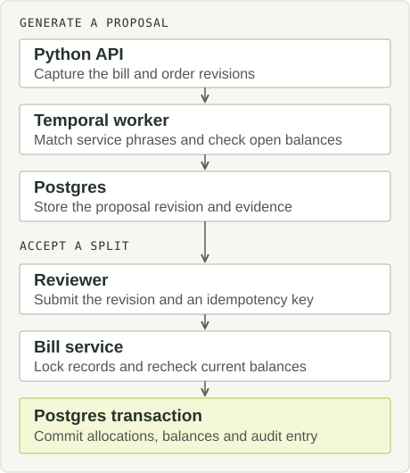

# Architecture

Phrase matching identifies the billed services. Integer-cent arithmetic determines the allocation. The reviewer authorizes the write.

## Running in the browser

React loads the selected invoice and purchase order from synthetic fixtures. The browser loads the bundled Model2Vec vocabulary and weights once per workspace session. Wording checks can hold a phrase before inference. For scored phrases, the matcher compares the embedding with service examples and requires both a similarity of 0.84 and a lead of 0.16 over the next category.

For a payable service, the matcher also checks the words in the phrase against the reviewed vocabulary for that line. An unfamiliar qualifier sends the bill to review and the evidence panel retains the score. The allocation logic then requires two distinct matches and an exact total in cents. Accepting rechecks eligibility and saves the decision in the tab’s session storage when available. On reload, the app revalidates the saved decision and derives the displayed balances from the fixture.

## Proposed shared backend

### Generate a proposal

A Python API captures bill and order revisions. A Temporal worker could run a local matcher or call a hosted decision model such as Jev. The matching request needs the billed phrase and the candidate service descriptions. The result identifies a service or returns “unclear.” The worker applies the wording and balance checks, then stores the proposal revision, proposed cents per line and supporting phrase in Postgres. A hosted timeout or unclear result leaves the bill available for manual review.

### Accept against current balances

The reviewer submits the proposal revision and an idempotency key to the service that owns the bill. That service authorizes the reviewer, locks the bill and order lines in a consistent order, and checks their current revisions and balances. A changed balance invalidates the proposal and sends the bill back for comparison.

### Commit once

One Postgres transaction records the two allocations, their order-line links, the balance updates, the audit entry and the result for the idempotency key. A retry of the same accepted request returns the recorded result. Matching retries can regenerate suggestions independently of this financial write.

## Why the demo runs Model2Vec

Potion 2M stays in the browser demo. A local check covered 38 synthetic phrases labeled setup, migration, support or unclear. All four candidates held the 16 phrases labeled unclear after applying the wording checks and score thresholds. The table counts how often each candidate identified the expected category on the remaining 22 phrases. [Inspect the phrase-level results (CSV)](../public/evaluation/phrase-results.csv)

| Local candidate | Valid phrases identified (of 22) | Approximate asset size |
| --- | --- | --- |
| Potion 2M | 7 | 2.29 MB |
| Potion 4M | 7 | 4.18 MB |
| Blink 8M | 4 | 8.08 MB |
| Bekko System One 17M | 6 | 29.02 MB for weights alone |

The embedding models used the same service examples and similarity thresholds. Bekko used its native four-way Choice head, the same wording exclusions, a minimum top probability of 0.80 and a minimum lead of 0.16. Its first choice for “data import” was unclear even before the probability check. The thresholds were fixed for this comparison. Scores from the two model families have different meanings.

These results cover a single prompt and a small synthetic sample. The current model deferred 15 of the 22 in-scope phrases, including “configure the account.” Improving that coverage requires evaluation on held-out vendor wording. [Potion 2M](https://huggingface.co/minishlab/potion-base-2M) · [Potion 4M](https://huggingface.co/minishlab/potion-base-4M) · [Blink 8M](https://huggingface.co/minishlab/blink-8M) · [Bekko browser model](https://huggingface.co/hotchpotch/bekko-system-one-v0-17m/tree/b886a1f9b91f4e8368d7830080d52d955e2c8dfa/onnx_browser)
