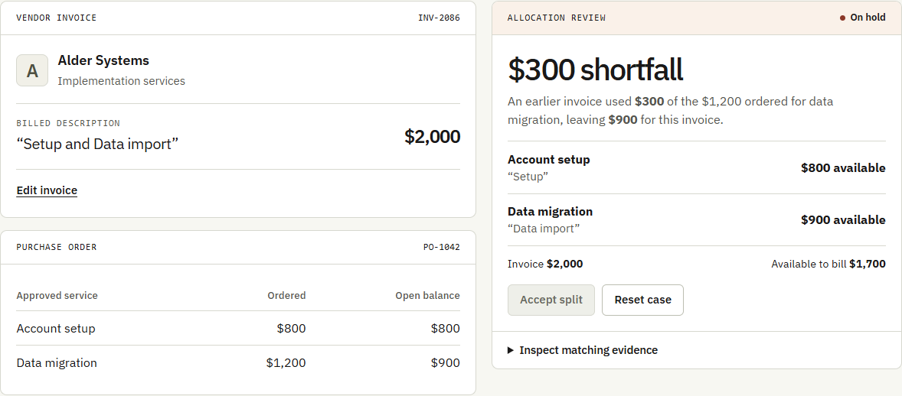

# Running and reviewing the demo

Use Node.js 24 or later and npm. Run `npm ci` to install the locked dependencies and `npm run dev` to start the loopback development server. Open its printed URL. `npm test` runs the matching and acceptance checks against the bundled model. `npm run build` type-checks the app and produces a standalone static site in `dist/`; `npm run preview` serves that build locally.

## Walkthrough

1. Open **Matching services**. Compare the invoice phrases against the two order lines. Accept the split and check both open balances. Reload the tab to see the recorded decision.
2. Open **Different service**. The invoice total is the same, but priority support has no matching order line. Use **Edit invoice** to change that phrase to “data import” and compare again.
3. Open **Used balance**. A prior invoice used $300 for migration, leaving $900. The $2,000 invoice exceeds the combined open balances by $300. Edit the total to $1,700 and choose **Compare changes**. Accept the $800 setup and $900 migration split to close both lines.
4. Open **Inspect matching evidence** to see the category, cosine similarity and margin for scored phrases. Wording such as “data import tax” shows the reason the check stopped before scoring. Use **Reset case** to restore that example independently.

## What actually runs

React and TypeScript render three independent synthetic cases. The browser saves compared edits and accepted decisions in the tab’s session storage. If the browser blocks storage, the app keeps changes in memory while the page is open and explains the reload limit. An accepted case displays zero on both order lines because the decision rule requires the bill to consume both open balances in full. Vendor, currency and the two order lines are fixed. The demo assumes a shared service period.

The browser downloads the bundled vocabulary, scales and quantized embeddings from the same origin. A greedy WordPiece tokenizer and normalized mean pooling produce a phrase vector. A candidate must clear both a cosine similarity threshold and a margin over the runner-up. For the two payable services, a final check holds phrases with words outside the reviewed vocabulary for that line. For example, “account setup guide” scores close to setup, but “guide” changes what the supplier may have delivered. The evidence panel shows the score and the word to check. These thresholds still need calibration on vendor data.

Weights are adapted from [potion-base-2M at the pinned revision](https://huggingface.co/minishlab/potion-base-2M/tree/389b9f64be5aa4ae7a6bc6fe95ef20ce485ae5da). The complete 64-dimensional embedding table uses symmetric int8 quantization per token with little-endian float32 scales. The upstream [license](../public/model/LICENSE.txt) accompanies the files.

## Hosting boundary

The production build can be served as static assets with no model key or external inference endpoint. Future static hosting can use `dist/` as its build output. The Architecture view describes the proposed Python API, durable matching worker and transactional acceptance flow. A multi-user release would require authoritative server-side balances and access control. [Architecture and model comparison](architecture.md)
